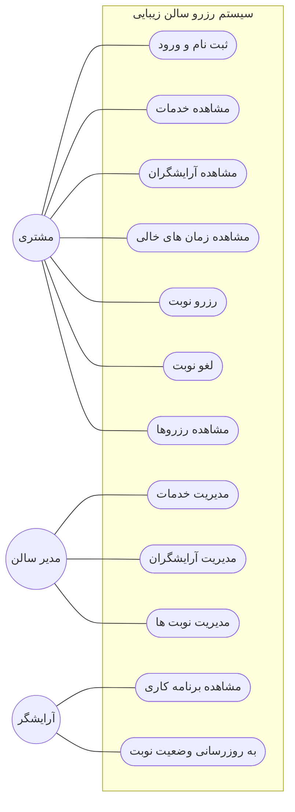
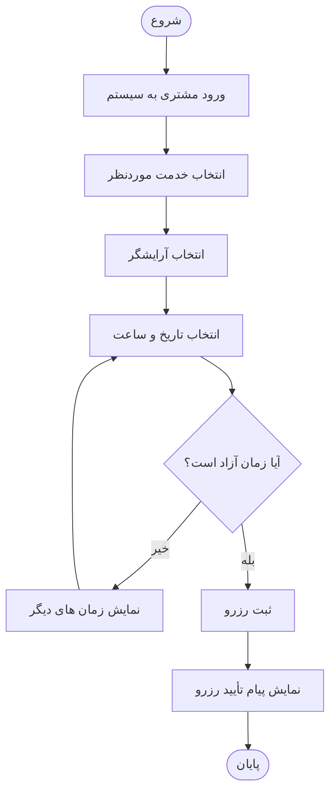

# پروژه ۳: مدل‌سازی نیازمندی‌ها و نمودارهای UML
## موضوع: سیستم رزرو سالن زیبایی

### ۱. مقدمه

هدف از طراحی سیستم رزرو سالن زیبایی، آسان کردن فرآیند رزرو خدمات برای مشتریان است. کاربران می‌توانند خدمات سالن را مشاهده کنند، آرایشگر موردنظر خود را انتخاب کنند و زمان مناسب را برای دریافت خدمات رزرو کنند.

### ۲. نمودار موارد کاربرد (Use Case Diagram)

در این سیستم سه بازیگر اصلی وجود دارد:

- مشتری (Customer)
- مدیر سالن (Admin)
- آرایشگر (Stylist)

وظایف مشتری:
- ثبت‌نام و ورود به سیستم
- مشاهده خدمات سالن
- مشاهده آرایشگران
- مشاهده زمان‌های خالی
- رزرو نوبت
- لغو نوبت
- مشاهده رزروهای خود

وظایف مدیر سالن:
- مدیریت اطلاعات مشتریان
- مدیریت خدمات سالن
- مدیریت آرایشگران
- مدیریت نوبت‌ها

وظایف آرایشگر:
- مشاهده برنامه کاری
- مشاهده نوبت‌های ثبت‌شده
- به‌روزرسانی وضعیت نوبت

### نمودار موارد کاربرد

### ۳. نمودار فعالیت (Activity Diagram)

این نمودار مراحل رزرو نوبت توسط مشتری را نشان می‌دهد.

مراحل فرآیند رزرو:

۱. مشتری وارد سیستم می‌شود.

۲. خدمات موردنظر را انتخاب می‌کند.

۳. آرایشگر موردنظر را انتخاب می‌کند.

۴. تاریخ و ساعت موردنظر را انتخاب می‌کند.

۵. سیستم خالی بودن زمان انتخاب‌شده را بررسی می‌کند.

۶. اگر زمان آزاد باشد، رزرو ثبت می‌شود.

۷. اگر زمان آزاد نباشد، مشتری باید زمان دیگری انتخاب کند.

۸. در پایان، پیام تأیید رزرو نمایش داده می‌شود.

### نمودار فعالیت فرآیند رزرو

### ۴. نتیجه‌گیری

با استفاده از نمودار Use Case می‌توان نقش کاربران و امکانات سیستم را مشخص کرد. همچنین نمودار Activity مراحل انجام فرآیند رزرو را نشان می‌دهد.

این دو نمودار به درک بهتر عملکرد سیستم رزرو سالن زیبایی و طراحی مناسب نرم‌افزار کمک می‌کنند.
